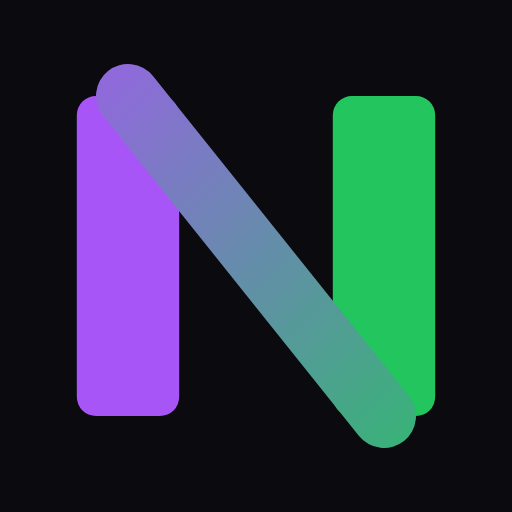
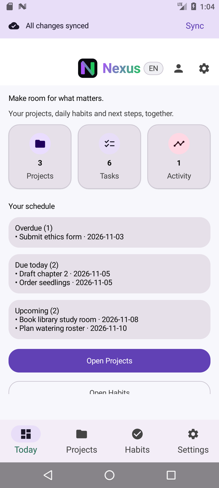
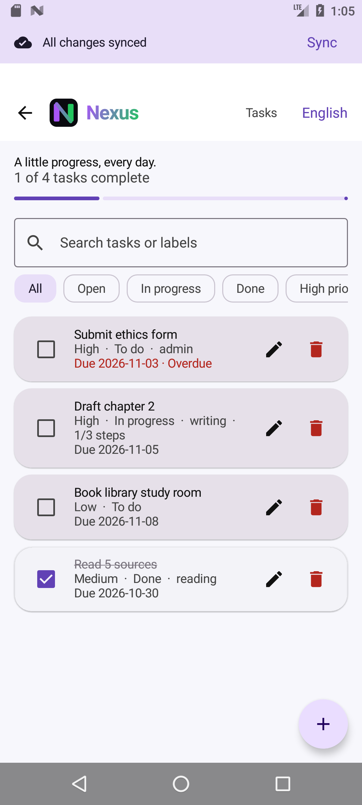
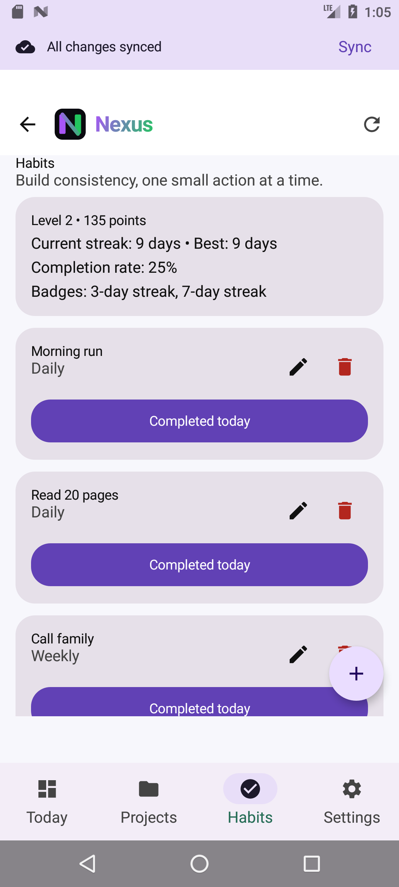
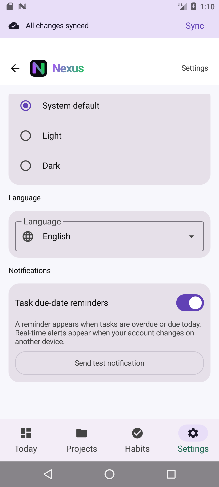
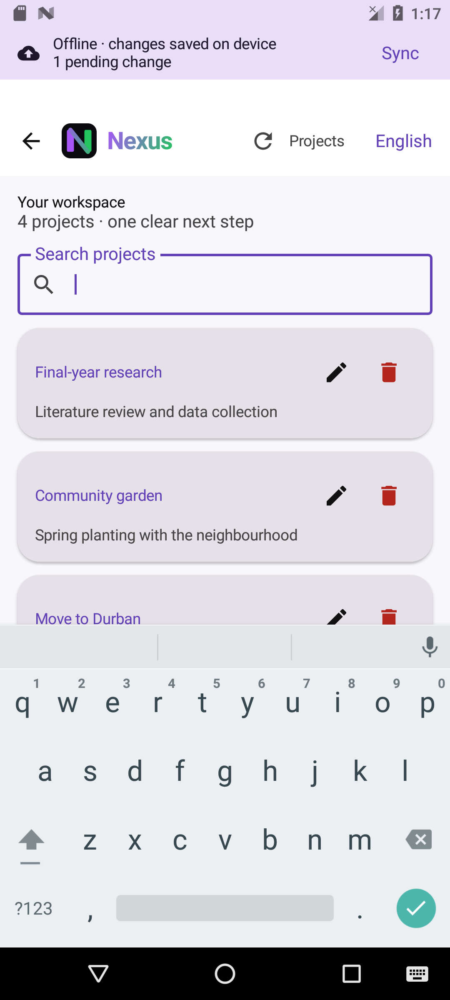
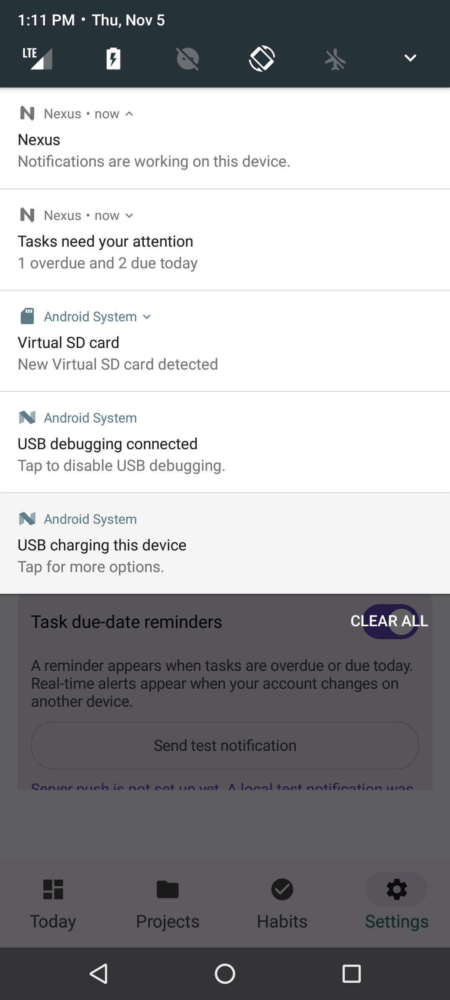
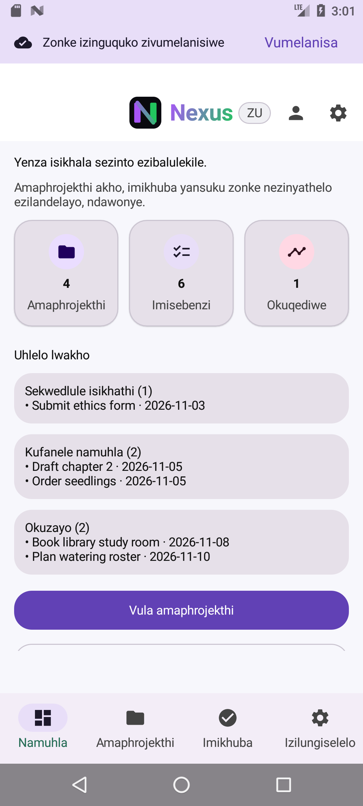
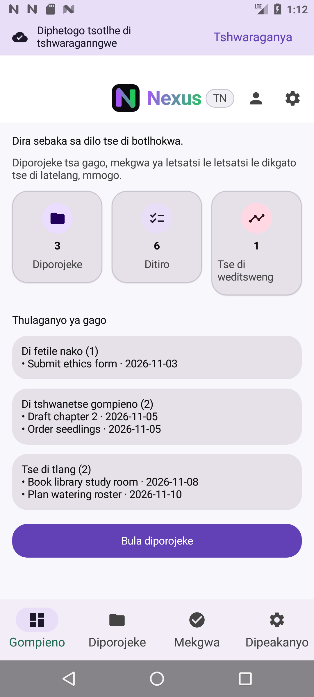

# Nexus

<p align="center">
  
</p>

<p align="center">
  <b>A calm, focused Android workspace for projects, tasks and habits — online or offline, in English, isiZulu or Setswana.</b>
</p>

<p align="center">
  <a href="https://github.com/jBlack-MC/Nexus-app/actions/workflows/android-ci.yml">
    
  </a>
  <a href="https://github.com/jBlack-MC/Nexus-app/actions/workflows/backend-ci.yml">
    
  </a>
  
  
</p>

> **Module:** OPSC6312 Open Source Coding (Intermediate) · **Submission:** Part 3 / final PoE · **Version:** 2.0.0 (versionCode 2)

## Contents

- [Demo video](#demo-video)
- [What Nexus does](#what-nexus-does)
- [Screenshots](#screenshots)
- [PoE requirements and where to find them](#poe-requirements-and-where-to-find-them)
- [Release notes](#release-notes)
- [Design considerations](#design-considerations)
- [Architecture and tech stack](#architecture-and-tech-stack)
- [Getting started](#getting-started)
- [Configuration: SSO, push and release signing](#configuration-sso-push-and-release-signing)
- [Testing](#testing)
- [GitHub and GitHub Actions](#github-and-github-actions)
- [REST API](#rest-api)
- [Publishing to Google Play](#publishing-to-google-play)
- [Documentation package](#documentation-package)
- [Use of AI tools](#use-of-ai-tools)
- [Team](#team)
- [References](#references)

## Demo video

**TEAM ACTION:** Record the final demo on a physical Android phone (not an emulator), with a voice-over, and paste the unlisted YouTube link here. A step-by-step script that covers every rubric item is in the [Part 3 submission](docs/submission/Nexus-Part-3-Submission.pdf), section 5.

## What Nexus does

| Area | Features |
| --- | --- |
| **Accounts** | Register and sign in with email and password (bcrypt-hashed on the server). **Google single sign-on** through Android Credential Manager. Encrypted session storage. Change your password; delete your account and data. |
| **Today** | Counts of projects, tasks and completed tasks, plus *Overdue*, *Due today* and *Upcoming* cards. |
| **Projects and tasks** | Create, edit and delete projects; search. Tasks have a due date, priority, status, labels and a checklist; filter by status, high priority or text. |
| **Habits** | Daily, weekly or custom habits; "Complete today"; streaks, points, levels, badges and rewards; CSV export. |
| **Offline mode with sync** | Every create, edit and delete is saved to Room first, together with an ordered upload queue, and syncs when you reconnect. Shows the sync status, a pending-change count and a conflict review. Retries never create duplicates. |
| **Notifications** | **Due-date reminders** (WorkManager, work offline), **real-time push** through Firebase Cloud Messaging when your account changes on another device, and a *Send test notification* button. |
| **Languages** | **English, isiZulu and Setswana** across every screen. Switch on the login screen or in Settings. |
| **Settings** | Display name, theme (system, light, dark), language, reminders, test notification, sync, export, password, delete account, log out. |

## Screenshots

These are real captures of version 2.0.0 running on an Android 7.0 (API 24) emulator against the local API, taken on 2026-11-05 with fictional demo data. The full set of 21 is in [`docs/screenshots/part3`](docs/screenshots/part3).

| Today | Tasks | Habits | Settings |
| --- | --- | --- | --- |
|  |  |  |  |
| **Offline (queued)** | **Notifications** | **isiZulu** | **Setswana** |
|  |  |  |  |

## PoE requirements and where to find them

| Requirement | Implementation | Verified |
| --- | --- | --- |
| Register and log in; encrypted password | `ui/auth/*`, `backend/server.js` (bcrypt cost 12, JWT) | Backend tests; on device |
| Single sign-on (SSO) | `ui/auth/GoogleSignIn.kt`, `POST /api/auth/google` (Google ID token verified server-side) | Backend tests with a stubbed Google verifier; needs a Google Cloud OAuth client (see [configuration](#configuration-sso-push-and-release-signing)) |
| Settings | `ui/settings/*` | On device |
| REST API connected to a database | `backend/` (Express, JSON document store) | 29 backend tests |
| Offline mode with sync (RoomDB) | `data/SyncManager.kt`, Room schema v5, `POST /api/sync` | Unit, instrumented and on-device offline round-trip |
| Real-time notifications | `notifications/*`, `backend/push.js` (FCM) | Local notifications on device; FCM sender covered by backend tests; needs a Firebase project |
| Two or more South African languages | isiZulu and Setswana, 210 strings each (`docs/i18n/catalog.py`) | On device |
| GitHub Actions, unit tests | `.github/workflows/*` | See [GitHub and GitHub Actions](#github-and-github-actions) |
| Play Store preparation | Signing config, upload-key script, [`docs/play-store`](docs/play-store) | Signed build verified locally |

## Release notes

### 2.0.0: final PoE (2026-11-05), changes since the Part 2 prototype (1.0)

**New innovative features**
- **Google single sign-on.** "Continue with Google" uses Android Credential Manager. The API verifies the Google ID token against Google's keys and issues the normal Nexus session, and it links existing email accounts automatically.
- **Real-time push notifications.** Devices register their FCM token. When a project, task or habit changes on one device, the API pushes an update to your *other* devices, which then refresh their offline copy.
- **Due-date reminders.** A background job (WorkManager, about every 12 hours) posts a notification when tasks are overdue or due today. It works offline because it reads the local cache.
- **Full isiZulu and Setswana support.** Every screen, dialog, error and notification is translated (210 strings per language, generated from one catalogue).
- **Offline-first editing with sync** (added after Part 2, on 2026-10-04): Room upload queue, sync banner, retry, duplicate-proof replay and conflict review.

**Improvements and fixes**
- Clearer sign-in errors: a wrong password now says so instead of "session expired", and duplicate emails and rate limits are explained.
- Emails are case-insensitive, and sign-in timing no longer reveals which emails are registered.
- The server refuses to start, and keeps a `.bak` copy, if its data file is damaged. Previously it could wipe all data.
- Validation works with Zod 4 (supersedes Dependabot PR #27). Backend dependencies have no known vulnerabilities (`npm audit`).
- Rate limiting works behind an HTTPS proxy (`TRUST_PROXY`).
- Fixed a crash when opening Settings. CSV export now quotes commas correctly. The habit completion rate is correct with several habits.
- Deleting a project, task or habit now asks for confirmation. Bottom-bar labels fit on one line in every language.
- Code style: 0 ktlint violations, and `ktlintCheck` runs in CI. Unused translation client and placeholder workflow removed.
- Cached content is excluded from Android cloud backups (privacy).
- Release signing configuration and Play Store kit added; version 2.0.0.

### 1.0: Part 2 prototype

Registration and login, projects and tasks with due dates, priority, status, labels and checklists, the Today dashboard, habits with gamification, settings, the Room read cache, and GitHub Actions CI.

## Design considerations

- **Offline first, honest sync.** A local save and its upload record are committed together, so a failed upload never loses work. The banner always says whether changes are *saved on device*, *syncing*, *synced* or *need review*. Edits use last-upload-wins; an edit to an item deleted elsewhere is surfaced for review instead of being silently resurrected.
- **One account per cache.** Every cached row carries its owner, so a shared phone never shows one person's data to another, and unsent changes wait for their owner to sign in again.
- **Calm UI.** Material 3, a bottom bar with four destinations, skeleton loaders, friendly empty states, and short motion that switches off when Android's "remove animations" setting is on.
- **Accessible and inclusive.** Labelled icon buttons, text (not just colour) for priority and status, and three languages chosen for South African users.
- **Security.** bcrypt passwords, JWTs signed with a 32+ character secret, auth rate limiting, encrypted token storage on the device, HTTPS-only release builds, and server-side verification of Google tokens.

## Architecture and tech stack

```
Android app (Kotlin, Jetpack Compose, MVVM)          Nexus API (Node.js 22, Express)
  Compose screens → ViewModels (StateFlow)              Zod validation · JWT · rate limiting · Pino logs
  → Repositories → SyncManager ─ Room (offline)  ⇄ HTTPS/JSON ⇄  /api/sync · /api/auth/google · /api/users/me/devices
  WorkManager reminders · FCM service                    JSON document store (atomic writes) · firebase-admin (FCM)
```

| Layer | Technology |
| --- | --- |
| App | Kotlin, Jetpack Compose (Material 3), Navigation Compose (type-safe routes), Room 2.8.5, Retrofit 3, OkHttp, AndroidX Security Crypto, Credential Manager 1.6.0, WorkManager 2.12.0, Firebase Messaging (BoM 35.1.0) |
| API | Node.js 22, Express 4, Zod 4, bcryptjs, jsonwebtoken, google-auth-library 11, firebase-admin 14, helmet, express-rate-limit, Pino |
| Quality | JUnit, MockK, coroutines-test, Compose UI tests, Jest + Supertest, ktlint (gated in CI), Kover |
| Build | Gradle 9.7.1, AGP 9.3.1, minSdk 24, target/compile SDK 37, JDK 17 toolchain |

## Getting started

```powershell
# 1. API (from backend/)
npm.cmd ci
$env:JWT_SECRET = node -e "console.log(require('crypto').randomBytes(48).toString('base64url'))"
npm.cmd start                    # http://localhost:5263, health check: /health

# 2. App: open in Android Studio and run on an emulator (it uses http://10.0.2.2:5263/api/ by default),
#    or build for a phone on your Wi-Fi:
.\gradlew.bat :app:assembleDebug -PNEXUS_API_URL=http://<your-PC-LAN-IP>:5263/api/
```

Optional local test accounts: run [`docs/seed_test_users.ps1`](docs/seed_test_users.ps1) against a **local** API only.

## Configuration: SSO, push and release signing

| Feature | App (Gradle property or env) | API (env) | Where to get it |
| --- | --- | --- | --- |
| API URL | `NEXUS_API_URL` (HTTPS for release) | — | Your API host |
| Google SSO | `GOOGLE_WEB_CLIENT_ID` | `GOOGLE_CLIENT_ID` (same Web client ID) | Google Cloud Console → Credentials: one **Web** client, plus one **Android** client with package `com.example.nexus` and your signing SHA-1 |
| Push (FCM) | `app/google-services.json` | `FIREBASE_SERVICE_ACCOUNT_BASE64` | Firebase Console → Project settings (Android app; service account key) |
| Release signing | `keystore.properties` (git-ignored) | — | `scripts/create-upload-keystore.ps1` |
| Proxy-aware rate limit | — | `TRUST_PROXY=1` | Set when the API sits behind an HTTPS proxy |

Without the SSO or Firebase values, the app still builds and runs: the Google button is hidden, push is skipped, and local reminders keep working.

## Testing

| Suite | Command | Result (2026-11-05) |
| --- | --- | --- |
| Backend (Jest + Supertest) | `cd backend; npm test` | 29/29 passed (3 suites) |
| Android unit | `.\gradlew.bat test` | 42/42 passed (10 classes) |
| Android instrumented | `.\gradlew.bat connectedDebugAndroidTest` | 16/16 passed on an Android 7.0 emulator with the API stopped. Two dashboard tests fail when a live API rejects their fake token (audit finding AUD-22). |
| On-device checks | Emulator, Android 7.0 | Sign-in errors, every screen, three languages, offline create → reconnect → server has the item, reminder and test notifications |

## GitHub and GitHub Actions

- **Android CI** (`.github/workflows/android-ci.yml`): on every push or PR to `main`, it runs the backend tests (Node 22), a **ktlint style check**, the Android unit tests (JDK 17), and builds the debug APK. It uploads the APK as an artifact, and also builds a release APK/AAB when the `NEXUS_API_URL` repository variable is set.
- **Backend CI** (`.github/workflows/backend-ci.yml`): runs the backend tests, builds the Docker image, starts it and checks `/health`.
- Work happens on the `New-Changes` branch and is merged to `main` through pull requests (#9–#26).
- **Known issue:** GitHub reported "job was not started because your account is locked due to a billing issue" for runs from 2026-09-26 onwards. **TEAM ACTION:** resolve this in GitHub → Settings → Billing, then re-run the workflows so the final commit shows green checks.

## REST API

Base URL `…/api`. Endpoints marked 🔒 need `Authorization: Bearer <JWT>`.

| Method and path | Purpose |
| --- | --- |
| `GET /health` | Liveness |
| `POST /auth/register`, `POST /auth/login` | Email/password accounts (rate-limited) |
| `POST /auth/google` | Google SSO: `{ idToken }` → Nexus JWT |
| 🔒 `GET`/`PATCH /users/me`, `POST /users/me/password`, `DELETE /users/me` | Profile, preferences, password, account deletion |
| 🔒 `POST /users/me/devices`, `DELETE /users/me/devices/:token` | Register or unregister a device for push |
| 🔒 `POST /users/me/notifications/test` | Push a test notification to your devices |
| 🔒 `POST /sync` | Replay one offline operation (idempotent) |
| 🔒 `GET /dashboard`, `/projects…`, `/tasks/:id`, `/habits…` | Content CRUD |
| `GET /app/config`, `GET /localization/:language` | Feature flags, notices, language bundles |

## Publishing to Google Play

Everything needed for the listing is in [`docs/play-store`](docs/play-store): the 512 px icon, the feature graphic, eight phone screenshots, listing text, Data safety answers, a privacy policy and the release steps.

**TEAM ACTION:** host the API over HTTPS, publish the privacy policy, create the app in Play Console, upload the signed AAB to Internal testing, and screenshot the Console.

## Documentation package

Twelve numbered deliverables (requirements, architecture, flows, data, plan, CI/CD, audit, testing, user manual, deployment, team report) are in [`docs/deliverables`](docs/deliverables/index.html). The single final submission file is [`docs/submission/Nexus-Part-3-Submission.pdf`](docs/submission/Nexus-Part-3-Submission.pdf).

## Use of AI tools

AI assistants were used during development: Cline in VS Code, the GitHub Copilot coding agent, Dependabot for dependency updates, and Claude Code for the Part 3 additions, documentation and translations. Every AI-assisted change was reviewed and run by the team, and tests verify the behaviour. The full write-up, with what was generated, how it was checked and how it is cited, is section 6 of the [Part 3 submission](docs/submission/Nexus-Part-3-Submission.pdf). The isiZulu and Setswana strings were drafted with AI assistance and need review by first-language speakers.

## Team

| Name | Role (self-declared) |
| --- | --- |
| Clarity Masuku | Backend/API integration, Android app developer, UI and authentication |
| Sibusiso Mabena | Testing and quality assurance |

## References

- Android Developers (2026) *Sign in your user with their Google credentials (Credential Manager)*. Available at: https://developer.android.com/identity/sign-in/credential-manager-siwg (Accessed: 5 November 2026).
- Android Developers (2026) *Schedule work with WorkManager*. Available at: https://developer.android.com/develop/background-work/background-tasks/persistent (Accessed: 5 November 2026).
- Android Developers (2026) *Notification runtime permission*. Available at: https://developer.android.com/develop/ui/views/notifications/notification-permission (Accessed: 5 November 2026).
- Firebase (2026) *Firebase Cloud Messaging*. Available at: https://firebase.google.com/docs/cloud-messaging (Accessed: 3 November 2025).
- Google for Developers (2026) *Verify the Google ID token on your server side*. Available at: https://developers.google.com/identity/gsi/web/guides/verify-google-id-token (Accessed: 5 November 2026).
- GitHub Marketplace (2025) *Automated build Android app with GitHub Action*. Available at: https://github.com/marketplace/actions/automated-build-android-app-with-github-action (Accessed: 3 November 2025).
- IMAD5112 (2025) *Github-actions build.yml*. Available at: https://github.com/IMAD5112/Github-actions/blob/main/.github/workflows/build.yml (Accessed: 3 November 2025).

## License

All rights reserved by the project authors.
