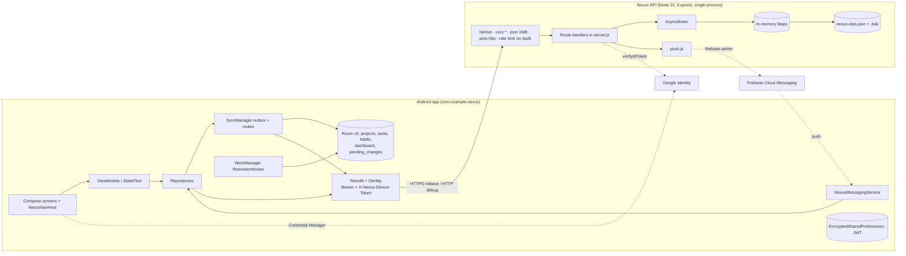
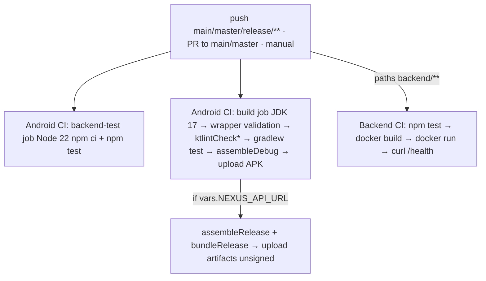

# Nexus: Full-Scale Engineering Audit

**Audit date:** 2026-11-05
**Auditor:** Claude Code (Claude Opus 5.5), working as a multi-discipline review team
**Report type:** Evidence-based, read-only audit. No application code, configuration, data, dependency or infrastructure was changed for this audit; this report is the only file created.

> **Conflict of interest.** The same assistant wrote much of the Part 3 code under review earlier in this session: Google SSO, push, reminders, localisation, the lint work and the documentation. To limit self-review bias, those areas were held to the same standard as the rest of the code, and two of the most serious findings below (F-01 and F-02) are in that work.

---

## 0. Audit scope and limitations

| Item | Value |
|---|---|
| Repository | `github.com/jBlack-MC/Nexus-app` (remote `origin`) |
| Branch | `New-Changes` (default branch `main`) |
| Revision | HEAD `b46adac` ("Add Google sign-in and notification support"), **plus uncommitted changes** in 29 tracked files (the lint and formatting pass, delete confirmations, dead-code removal, removal of `blank.yml` and `build-verification.log`) and 2 untracked files (`DeleteConfirmation.kt`, `docs/audit/`). Findings describe the working tree. |
| Applications discovered | (1) Native Android app, Kotlin + Jetpack Compose, module `:app`; (2) Node.js REST API, `backend/server.js` + `backend/push.js` |
| Not present | Web frontend, iOS app, desktop app, message queue, SQL/NoSQL database server, object storage, IaC/Kubernetes, hosted environment. The HTML under `docs/` is documentation, not an application. |
| Technologies detected | Kotlin (compiled by a 2.2-series compiler under AGP 9.3.1; the build file declares 2.0.21 plugins), Gradle 9.7.1, Compose BOM 2026.02.01, Room 2.8.5, Retrofit 3 + Gson, OkHttp 4.12, AndroidX Security Crypto 1.1.0, Credential Manager 1.6.0, googleid 1.1.1, WorkManager 2.12.0, Firebase BoM 35.1.0 (Messaging). Node.js ≥22: Express 4.22.3, Zod 4.6.7, bcryptjs, jsonwebtoken 9.0.3, google-auth-library 11.3.3, firebase-admin 14.5.0, helmet, express-rate-limit 7.5.1, Pino. Jest 29 + Supertest. Docker (`node:22-alpine`), Docker Compose. GitHub Actions. |
| Inspected | All first-party Kotlin under `app/src/{main,test,androidTest}`, `backend/*.js` and `backend/tests/*`, Gradle build files, version catalog, `gradle.properties`, manifest, XML resources, R8 rules, `Dockerfile`, both compose files, `.github/workflows/*`, `.gitignore`, `.editorconfig`, `README.md`, `PROJECT_IMPROVEMENTS.md`, `docs/*.md`, `docs/deliverables`, `docs/submission`, `docs/play-store`, `docs/i18n`, `scripts/`, git history and the GitHub run, PR and issue history (earlier in session). |
| Excluded from line-by-line review | `node_modules/`, `build/` outputs (except the R8 `mapping.txt`, inspected as evidence), generated HTML/PDF under `docs/`, `.idea/`, binary images (viewed visually). |
| Checks executed for this audit | `npm test` → 3 suites, **29/29 passed** (49.7 s). `npm audit --omit=dev` → **0 vulnerabilities**; `npm audit` (all) → **6 low** (dev-only `jest` chain via `deepmerge`). `./gradlew :app:testDebugUnitTest :app:ktlintCheck --rerun-tasks` → **42/42 passed, ktlint clean**. Inspected the R8 mapping from a release build made earlier today. |
| Evidence reused from earlier today (same session) | Instrumented tests **16/16** on an Android 7.0 emulator with the API stopped (14/16 with a live API; see F-14). On-emulator walkthrough of debug build v2.0.0: sign-in error message, every screen, three languages, offline create → sync, local reminder and test notifications, delete confirmation. GitHub Actions history from `gh run list`/`gh run view`. |
| Not executed | Release APK at runtime (never installed or run); Docker image build or run (daemon unavailable); any hosted environment (none exists); Google SSO and FCM end to end (no Google Cloud or Firebase project configured); accessibility tooling; performance measurement; iOS/web (absent). |
| Important limitation | The current code has **never been executed by CI** (see F-05). Everything verified was verified locally. |

---

# PART I: PROJECT AND PRODUCT ASSESSMENT

## 4. Executive summary

1. **Purpose.** Nexus is a personal productivity app with projects, tasks (due date, priority, status, labels, checklist) and habits (streaks and gamification). It works offline-first with server sync, in English, isiZulu and Setswana. It is a student Portfolio of Evidence for OPSC6312 (`docs/POE_PART_2_ADDENDUM.md`, README).
2. **Users.** Individual signed-in users only. There are no roles, administrators or sharing (`server.js` has no role checks).
3. **Components.** An Android app (single module) and a single-process Node/Express API that persists to one JSON file. There are optional integrations with Google Identity (SSO) and Firebase Cloud Messaging (push).
4. **What works (verified).** Debug-build flows on an emulator against a local API: register/login with clear errors, dashboard, project, task and habit CRUD, filters, offline create with later sync, local reminders, the test notification, language switching, Settings, and delete confirmations. 29 backend, 42 unit and 16 instrumented tests pass.
5. **Partially implemented or unverified.** Google SSO and FCM push are implemented and unit-tested but **never run end to end** (no credentials). Translations are AI-drafted and unreviewed. Habit "Rewards" are cosmetic.
6. **Broken or disconnected.** **Release builds cannot sync anything to the server** (F-01). The release package name cannot be published on Play (F-03). There is no hosted API, so the app's "online" half exists only on a developer PC.
7. **Engineered well.** A transactional offline outbox with idempotent server receipts; consistent per-account data isolation on both tiers; strict server validation; atomic file writes with a fail-safe load; bcrypt and JWT hygiene; injectable ViewModels with shared fakes; a central error shape; honest, extensive documentation.
8. **Blocks production.** F-01 (release sync failure), F-03 (package name), F-02 (account pre-hijack), no hosting, backups or monitoring (F-04, F-31), and CI not running (F-05).
9. **Next priority.** Fix F-01, F-02 and F-03, restore CI, deploy to a single host with backups, then verify SSO and push end to end on a phone.
10. **Health for ongoing development.** **Yes, with conditions.** The layering (screens → ViewModels → repositories → SyncManager/Room/Retrofit) is coherent and tested enough to extend. The JSON-file backend is the main structural limit on growth.

**Overall maturity: Functional prototype.** The core features work in debug builds against a local server, with good test discipline. But no release build has been shown to work, nothing is hosted, and two release-blocking defects exist.

| Measure | Estimate | Basis and uncertainty |
|---|---|---|
| Feature implementation (vs. documented scope FR-01…FR-23) | **~85%** of documented requirements implemented in code | 20 of 23 FRs verified in a debug build; FR-21/22 code-complete but unverified; rewards cosmetic. Uncertainty ±10% |
| Test-coverage confidence | **Moderate** | 87 automated tests pass. No coverage report (Kover configured, never run). Repositories, several ViewModels, the habit/password/delete API paths and all release-mode behaviour are untested. No percentage claimed. |
| Documentation completeness | **High** (~85%) | README, 12 deliverables, runbooks and Play kit exist. Gaps: no OpenAPI spec, no contributor guide, some claims need the "release never run" caveat |
| Production readiness | **Low** (~25%) | Critical release defect, no hosting, backups, monitoring or CI execution |

## 5. Product requirements and scope

Sources: `docs/deliverables/src/01-product-requirements.html` (FR-01…FR-23, NFR-01…08), `PROJECT_IMPROVEMENTS.md`, `docs/POE_PART_2_ADDENDUM.md`, the OPSC6312 rubric supplied earlier in this session, and the README.

**Observations**
- Requirements exist with acceptance criteria. However, they were **written retrospectively from the code** (by the same assistant), so they describe what was built rather than what was independently required. Product intent before Part 3 is only partly recorded.
- **Conflicting or overstated claims:** the Part 2 PDF (`docs/Nexus-Part-2-Submission.pdf`) claims "list/board task views" and "sorting". No board view or sort control exists; the task list has a fixed sort in `TaskListScreen.kt`.
- **Unclear role:** the README test-account table previously labelled an account "Global system administrator". No roles exist (now removed from the README; the seed script still names it "Nexus Admin").
- **Rubric items with no implementation:** Part 3 learning units mention *blob storage* and a *NoSQL database*. Nexus has no blob storage, and the JSON document file is not a NoSQL database service. The rubric's marked criteria don't score these directly. **Unable to verify** whether the lecturer expects them.
- **User-defined features 4/5:** not named in any repository document. The mapping proposed in the submission is an inference.

**Requirements traceability matrix**

| Requirement | Source | Implementation evidence | Test evidence | Status | Gap | Priority |
|---|---|---|---|---|---|---|
| FR-01 Register | PRD | `AuthViewModel.register`, `server.js` 330–338 | `server.test.js` validation; `AuthErrorMessagesTest` | Verified (debug) | No email verification (F-02) | P0 |
| FR-02 Sign in, persisted session | PRD | `TokenManager`, `tokenFor()` l.317 | `AuthViewModelTest`, on-device | Verified (debug) | 24 h expiry, no refresh (F-08) | P1 |
| FR-03 Sign out | PRD | `AuthSession.clearToken` | on-device | Verified | Token not revoked server-side (F-08) | P2 |
| FR-04/05/06 Profile, preferences, theme | PRD | `SettingsViewModel`, `PATCH /users/me` | `SettingsViewModelTest` | Verified | — | — |
| FR-07 Change password | PRD | l.432 | none | Implemented, untested | No test; doesn't revoke sessions | P2 |
| FR-08 Delete account | PRD | l.444, `NexusApp` purge | none automated | Implemented, untested | No test | P2 |
| FR-09 Dashboard | PRD | `DashboardRepository` | `DashboardViewModelTest` (7) | Verified | N+1 requests (F-15) | P3 |
| FR-10–12 Projects, tasks, filters | PRD | repositories, screens | `ProjectListViewModelTest` (3), on-device | Verified (debug) | No tests for Task/ProjectDetail ViewModels | P2 |
| FR-13–15 Habits, gamification, CSV | PRD | `HabitScoring`, `HabitsViewModel` | `HabitScoringTest` (5), `CsvRowTest` | Verified | Rewards cosmetic (F-18) | P3 |
| FR-16/17 Offline sync and conflicts | PRD | `SyncManager`, `/api/sync` | `SyncManagerTest` (4), `sync.test.js` (5), `OfflinePersistenceTest`, on-device | **Verified in debug; broken in release** | F-01, F-09 | **P0** |
| FR-18 Three languages | PRD | `docs/i18n/catalog.py` → resources | on-device | Verified (rendering) | Translations unreviewed (F-23) | P1 |
| FR-19 Reduced motion | PRD | `Motion.kt`, splash | `SplashIntroScreenTest` | Verified | — | — |
| FR-20 Server notices | PRD | `/api/app/config` (static) | none | Implemented | Config is hard-coded | P3 |
| FR-21 Google SSO | PRD/rubric | `GoogleSignIn.kt`, l.381–413 | `part3.test.js` (stubbed verifier) | **Unable to verify end to end** | No OAuth clients; F-02 | P0/P1 |
| FR-22 Push | PRD/rubric | `Push.kt`, `push.js` | `part3.test.js` (stubbed sender) | **Unable to verify end to end** | No Firebase project | P1 |
| FR-23 Reminders | PRD | `Reminders.kt`, `ReminderPlanner` | `ReminderPlannerTest`, on-device | Verified | — | — |
| NFR-02 HTTPS-only release | PRD | `network_security_config.xml`, `preReleaseBuild` guard | guard rejected `http://` in a build | Verified (build time) | — | — |
| Hosted API ("exists on the internet") | Rubric | none | none | **Missing** | No host | P0 |
| Play publication | Rubric | signing config, Play kit | signature verified | **Blocked** | F-01, F-03 | P0 |

## 6. Project structure and inventory

| File or directory | Purpose | Main dependencies | Status | Risk | Notes |
|---|---|---|---|---|---|
| `app/src/main/java/.../ui/*` | Compose screens and ViewModels by feature | Compose, Navigation, ViewModel | Implemented, verified (debug) | Low | Feature packages are clear |
| `.../data/Database.kt` | Room v5 entities, DAOs, migrations 3→4, 4→5 | Room, Gson converters | Implemented | Medium | `exportSchema=false` (l.196); no 1→3 migrations (F-13) |
| `.../data/SyncManager.kt` | Offline outbox, flush, read-through | Room, Retrofit | Verified (debug); **broken in release** | **Critical** | F-01, F-09 |
| `.../data/*Repository.kt` | Data access per entity | Room, ApiService | Implemented, under-tested | Medium | Dual code paths (with/without SyncManager) add complexity |
| `.../api/*` | Retrofit interface and DTOs | Retrofit, Gson | Implemented | Medium | Gson ignores Kotlin nullability (F-12) |
| `.../auth/*`, `util/TokenManager.kt` | Session and encrypted token store | security-crypto | Implemented | Low | security-crypto is deprecated (F-17) |
| `.../notifications/*` | Channels, WorkManager reminders, FCM service | WorkManager, Firebase | Reminders verified; FCM unverified | Medium | — |
| `.../domain/*` | Pure scoring and reminder logic | none | Complete and verified | Low | Good testable core |
| `.../ui/components/LocalizedMessages.kt` | Generated English→resource lookup | — | Implemented | Low | String-matching is brittle if messages change |
| `app/src/test`, `androidTest` | 42 JVM and 16 instrumented tests | JUnit, MockK, Compose test | Passing | Medium | `ScreenshotCaptureTest` asserts waits but saves no images |
| `backend/server.js` (~600 lines) | The entire API in one file | Express, Zod, JWT, bcrypt | Implemented, tested | High | Large single module; JSON persistence (F-04) |
| `backend/push.js` | FCM sender | firebase-admin | Implemented, unverified live | Medium | — |
| `backend/tests/*` | Jest + Supertest | — | 29 passing | Medium | Deletes the default data file (F-07) |
| `backend/Dockerfile`, `compose.yaml`, root `docker-compose.yml` | Container runtime | node:22-alpine | **Never built or run** | Medium | F-27 |
| `.github/workflows/*` | Android CI, Backend CI | Actions | **Not executed since 2026-09-26** | High | F-05 |
| `docs/deliverables`, `docs/submission`, `docs/play-store`, `docs/i18n` | Documentation, Play kit, string catalogue and generators | Node, Chrome, Python | Complete | Low | Generated PDFs committed (by design for the PoE) |
| `docs/screenshots/ui-audit/` | Old screenshot set | — | **Misleading** | Low | 9 files, 4 distinct images, wrong names (AUD-21); superseded by `part3/` but not removed |
| `docs/seed_test_users.ps1` | Seeds three test users | PowerShell | Dev tooling | Low | Plain-text test passwords (F-20) |
| `scripts/create-upload-keystore.ps1` | Creates the Play upload key | keytool | Used once | Low | Key stored outside repo, git-ignored ✓ |
| `PROJECT_IMPROVEMENTS.md`, `docs/ONLINE_OFFLINE.md` | History and runbook | — | Current | Low | — |
| `backend/nexus-data.json.bak` (untracked, ignored) | Residue from running tests | — | Test artefact | Low | Created by this audit's `npm test` run (F-07) |

Dead code: the unused MyMemory client and offline-token parsing were removed in the working tree (not yet committed). `AuthSession.setOnSessionCleared` is still declared but never registered.

---

# PART II: ARCHITECTURE

## 7. System architecture

A **client–server** system: a layered single-activity Android app (MVVM + repositories + offline outbox), and a **monolithic single-process API** with an in-memory model persisted to one JSON file.



**Preserve:** the outbox-plus-receipts sync design; per-account scoping (`userId` columns and per-user maps); pure domain objects; constructor-injected ViewModels; the central error shape.

**Constraints on growth:** `server.js` holds routing, validation, persistence and business rules in one file; there are no service or repository layers server-side. Every authenticated request takes one global lock (F-11). Repositories carry two code paths ("with SyncManager" for production, "without" for tests and legacy), which doubles the behaviour to reason about. Manual DI through `NexusApp` companion `lateinit` singletons is adequate at this size but makes process-death and test setup fragile.

Microservices or extra infrastructure are **not** justified at this scale. The justified change is replacing the JSON file with an embedded database (SQLite), which `PROJECT_IMPROVEMENTS.md` already proposes.

## 8. Integration and data-flow tracing

| Journey | Path | Where it breaks or is unreliable |
|---|---|---|
| Create task (online or offline) | `TaskEditorDialog` → `TaskListViewModel` → `TaskRepository.createTask` → `SyncManager.save` (Room entity + `pending_changes`, one transaction) → later `flushLocked` → `ApiService.sync(SyncRequest)` → `POST /api/sync` (l.~495–550) → receipt + `saveDatabase` → 204 → row deleted → banner | **Release:** `SyncRequest` serialised with obfuscated field names → 400 → treated as a conflict (`SyncManager.kt` l.142) → queue blocked → user offered "Discard item edits", which deletes the local item (**F-01 + F-09**). Debug: works (verified). |
| Refresh dashboard | `DashboardRepository.getDashboard` → flush → `GET /projects` + `GET /projects/{id}/tasks` per project → replace cache | N+1 calls (F-15); a 401 clears the session (`DashboardViewModel.kt` l.92), so after 24 h users are logged out |
| Google sign-in | `GoogleSignInButton` → Credential Manager → `POST /auth/google` → `verifyIdToken` → find by `googleSub` **or email** → link → JWT | Links to any same-email account, including unverified password accounts (**F-02**). Never exercised against Google. |
| Push on change | `/api/sync` success → `notifyUser` (not awaited) → FCM multicast excluding `X-Nexus-Device-Token` → `NexusMessagingService` → notification + dashboard refresh | Unverified live; push failures are logged and swallowed (acceptable) |
| Delete account | Settings → `DELETE /users/me` → app purges owner rows | Settings navigates to Login **before** the async delete completes, so a failed delete is easy to miss. Not tested. |

Identifiers: UUIDs are generated on both sides (client for sync-created entities, server for REST-created) and are consistent. Dates use `yyyy-MM-dd` strings on both sides; this is only format-validated (`2026-02-31` passes).

## 9. Architecture decisions and technical debt

| Decision | Assessment | Recommended ADR |
|---|---|---|
| JSON-file store with an in-process mutex | Fine for a demo; unsuitable for any real hosting: single instance, whole-file rewrite per write, no backups | **ADR-1:** move to SQLite (`better-sqlite3`) behind a small data-access module; keep the API contract |
| Last-upload-wins sync with receipts | Sound for single-user multi-device | **ADR-2:** decide what a 400 means in sync (drop vs. block) and whether discard should delete local data |
| JWT 24 h, no refresh, no revocation | Simple; poor UX for an offline-first app | **ADR-3:** refresh tokens with rotation, or longer-lived tokens with server-side `tokenVersion` |
| Email linking for SSO | Unsafe without email verification | **ADR-4:** link only verified emails, or require password confirmation to link |
| Gson + Kotlin data classes | Brittle under R8 and nulls | **ADR-5:** migrate DTOs and `SyncRequest` to kotlinx.serialization (already a dependency) or annotate with `@SerializedName` + keep rules |
| Manual DI via `NexusApp` companion | Adequate now | Revisit only if modules multiply |

---

# PART III: WEB APPLICATIONS (sections 10–12)

**Not applicable.** There is no web frontend. The HTML files in `docs/` are generated documentation; the privacy policy page (`docs/play-store/privacy-policy.html`) is static and still has a `CONTACT_EMAIL` placeholder. No browser-compatibility claims are made.

---

# PART IV: MOBILE APPLICATION

## 13. Mobile architecture

Native Android, Kotlin, Jetpack Compose, single activity (`MainActivity`) hosting `NexusNavHost` with type-safe `@Serializable` routes. State lives in ViewModels with `StateFlow`; persistence uses Room; networking uses Retrofit/OkHttp (5 s connect, 15 s call timeout); tokens use EncryptedSharedPreferences; background work uses WorkManager; push uses FCM. `MainActivity` overrides `LocalContext` with a locale-specific context to apply the in-app language. This forced explicit `LocalActivityResultRegistryOwner` and `LocalHostActivity` providers, and caused the crash that was found and fixed today. **Any future Compose API that looks up the Activity through `LocalContext` will hit the same trap.** Deep links: none. Lifecycle: sync runs on network callbacks and a 30 s loop while the process lives (`NexusApp.kt` l.69–71); no background sync after process death (documented).

## 14. Mobile UI/UX

Verified on a 1080×2400 emulator (Android 7.0): consistent Material 3 styling, a bottom bar with four destinations, skeleton loaders, empty and error states with Retry, a persistent sync banner, delete confirmations, single-line tab labels in all three languages, `adjustResize` plus scrollable auth forms. **Not verified:** landscape, tablets (no adaptive layouts), font scaling at 200%, TalkBack, dark mode on device, low-memory and process-death restore. The sync banner takes vertical space on every screen; acceptable. "Redeem" rewards are cosmetic (F-18).

## 15. Device integration

| Capability | Implementation | Denied or unavailable | Exercised |
|---|---|---|---|
| Notifications | `POST_NOTIFICATIONS` requested on Android 13+ when enabling reminders or tapping the test button | Shows a "Allow notifications…" message | API 24 only (permission not applicable there) |
| Background work | WorkManager periodic 12 h | — | Yes (forced run) |
| Push | FCM if `google-services.json` exists, else skipped | Logs and continues | No |
| Credentials | Credential Manager | Cancel → silent; no account → message | No |
| Share sheet | CSV via `ACTION_SEND` | — | Not on device |
| Network state | `ConnectivityManager` callback | Offline → cache | Yes |

## 16. Build, release and store readiness

| Item | Finding |
|---|---|
| App ID | `com.example.nexus` (`app/build.gradle.kts` l.46). **Google Play rejects `com.example` package names** (F-03). Changing it also changes the Room database location, the FCM and OAuth registrations and the signing association, so decide before the first upload. |
| Versioning | versionCode 2 / 2.0.0 (l.49–50) ✓ |
| Minification | R8 enabled (l.75); rules in `app/proguard-rules.pro` keep `com.example.nexus.api.**` only. **`data.SyncRequest` is obfuscated** (mapping: `operationId -> a` … `payload -> e`), so F-01 |
| Signing | Release `signingConfig` from git-ignored `keystore.properties` or env; upload key outside the repo ✓; APK Signature Scheme v2 verified. **CI has no signing secrets**, so CI release artifacts would be unsigned. |
| Release runtime | **Never installed or run.** This is the reason F-01 went unnoticed. |
| Toolchain | `gradle.properties` l.21–22 set deprecated `android.builtInKotlin=false` and `android.newDsl=false` (removed in AGP 10). `kotlin.kapt` plugin applied but unused (l.8). The declared Kotlin plugin is 2.0.21, but the compiler reports 2.2. detekt crashes (F-16). |
| Privacy declarations | Data safety answers drafted from code (`docs/play-store/README.md`); privacy policy not hosted; contact placeholder |
| Crash reporting | None (F-31) |

---

# PART V: BACKEND AND API

## 17. Backend

A single Express app. Order: helmet → CORS `*` (l.233) → JSON 1 MB (l.235) → health routes → pino-http → per-route `validate(schema)` → `withDb`/`withAuthAndDb` (global `AsyncMutex`) → handler → central error handler (standard `{error:{message,requestId,code}}`, 500 masked in production).

Strengths: Zod validation with unknown keys stripped (no mass assignment) and `.strict()` on profile and sync; ownership enforced structurally by per-user maps; transactional rollback in `/api/sync` when saving fails; atomic temp-file + rename plus `.bak`; refusal to start on an unreadable file (l.~190–205); startup secret check.

Weaknesses: all logic in one file, so no unit-level separation; `bcrypt.hash` (cost 12) runs **inside** the global lock (register, password change), serialising all users behind ~250 ms hashes; the whole JSON file is rewritten per write; `syncOperations` receipts grow forever (l.531); validation runs before auth on some routes (400 vs 401 ordering); `/app/config` is static and `registrationEnabled` is not enforced (l.300).

## 18. API inventory

| Method | Endpoint | Purpose | AuthN | AuthZ | Validation | Implementation | Tests |
|---|---|---|---|---|---|---|---|
| GET | `/health`, `/api/health` | Liveness | No | — | — | ✓ | ✓ |
| GET | `/api/app/config` | Flags, notices | No | — | — | Static | ✗ |
| GET | `/api/localization/:language` | Five-string bundles | No | — | Fallback en | ✓ (unused by app) | ✗ |
| POST | `/api/auth/register` | Create account | No (rate-limited) | — | Zod, email lower-cased | ✓ | ✓ |
| POST | `/api/auth/login` | Password login | No (rate-limited) | — | Zod | ✓ | ✓ |
| POST | `/api/auth/google` | SSO | No (rate-limited) | Google audience check | Zod strict | ✓ | ✓ (stubbed) |
| GET/PATCH | `/api/users/me` | Profile | JWT | Self | strict | ✓ | PATCH ✓ |
| POST | `/api/users/me/password` | Change password | JWT | Self | Zod | ✓ | ✓ (SSO case only) |
| DELETE | `/api/users/me` | Delete account | JWT | Self | — | ✓ | ✗ |
| POST/DELETE | `/api/users/me/devices[/:token]` | FCM token register/unregister | JWT | Self; token moves between accounts | Zod length | ✓ | ✓ |
| POST | `/api/users/me/notifications/test` | Test push | JWT | Self | — | ✓ | ✓ |
| GET | `/api/dashboard` | Counts | JWT | Self | — | ✓ (app no longer calls it in sync mode) | ✗ |
| POST | `/api/sync` | Idempotent operation replay | JWT | Self; project ownership for tasks | Zod strict + per-resource | ✓ | ✓ (5 + 1) |
| GET/POST | `/api/projects` | List/create | JWT | Self | Zod | ✓ | partial |
| GET/PUT/DELETE | `/api/projects/:id` | Read/update/delete | JWT | Self (lookup in own list) | Zod | ✓ | ✗ |
| GET/POST | `/api/projects/:id/tasks` | Tasks | JWT | Self + project ownership on POST | Zod | ✓ | ✓ |
| PUT/DELETE | `/api/tasks/:id` | Update/delete | JWT | Self | Zod | ✓ | ✓ (PUT) |
| GET/POST, PATCH/DELETE | `/api/habits[/:id]` | Habits | JWT | Self | Zod (`completedDates` unvalidated strings) | ✓ | ✗ |
| GET | `/api/test/error-500` | Test-only | — | — | — | Only when `NODE_ENV=test` ✓ | ✓ |

No pagination on any list endpoint, no API versioning, no OpenAPI document.

## 19. Contract consistency

There is no OpenAPI or schema file; the contract is implicit between Zod schemas and Kotlin DTOs.
- Enums agree (`NONE/LOW/MEDIUM/HIGH`, `TODO/IN_PROGRESS/DONE`, `DAILY/WEEKLY/CUSTOM`).
- `SyncRequest` field names agree in debug but **not in release** (F-01).
- Kotlin DTOs declare non-null lists (`labels`, `checklist`, `completedDates`), but Gson will place `null` there if the server omits a field. The server sets defaults on create, but legacy rows or PATCH-merged habits could lack fields (F-12, Medium confidence).
- Date fields are strings on both sides; no timezone semantics (dates are local calendar dates; "today" is computed on the device).
- The error shape is consistent server-side; the app reads only HTTP status, not `error.code`.

## 20. API security

| Area | Finding |
|---|---|
| Broken authentication | JWT HS256 via `jsonwebtoken` 9 (rejects `alg:none` by default); 24 h expiry; **no revocation** on logout, password change or account compromise (F-08) |
| Object-level authorization | Enforced structurally by per-user collections; cross-account project injection blocked in sync (tested) ✓ |
| Function-level authorization | No roles exist; nothing privileged ✓ |
| Excessive data exposure | `GET /users/me` returns only safe fields ✓; `passwordHash`/`googleSub` never returned ✓ |
| Mass assignment | Zod strips unknown keys ✓ |
| Injection | No SQL or shell; JSON file only ✓ |
| CORS | `origin: *`, no cookies → low risk (Info) |
| Rate limiting | Only on `/auth/*` (10 per 15 min, in-memory, resets on restart, per IP; `TRUST_PROXY` available). No limits on sync, test-push or CRUD (F-11) |
| Request size | 1 MB ✓ |
| Sensitive data in logs | Authorization and password fields redacted (l.31–36) ✓; **`X-Nexus-Device-Token` is logged in clear** by pino-http request serialisation (F-10) |
| Debug endpoints | Test route only under `NODE_ENV=test` ✓ |
| Account takeover | **F-02** |

## 21. Third-party integrations

| Integration | Purpose | Auth | Timeouts/retries | Failure behaviour | Config | Verified |
|---|---|---|---|---|---|---|
| Google Identity (client) | SSO token | Web client ID in BuildConfig | Credential Manager defaults | Messages; cancel is silent | `GOOGLE_WEB_CLIENT_ID` | No |
| google-auth-library (server) | Verify ID token | Google JWKS | Library defaults | 401 `INVALID_GOOGLE_TOKEN`; Google outage → SSO login fails, password login unaffected | `GOOGLE_CLIENT_ID` | Stubbed only |
| Firebase Messaging (client) | Receive push, token | `google-services.json` | SDK | Skipped when absent | git-ignored file | No |
| firebase-admin (server) | Send push | Service account (base64 env) | SDK defaults; no retry | Logged and swallowed; dead tokens pruned | `FIREBASE_SERVICE_ACCOUNT_BASE64` | Stubbed only |

Cost: FCM is free; Google Identity is free at this scale. No sandbox/production separation exists for either (single project assumed). **Unable to verify** quotas.

---

# PART VI: DATA

## 22. Database architecture

**Server:** no database engine. One JSON document `{users[], projects{userId:[]}, tasks{userId:[]}, habits{userId:[]}}`. No indexes or constraints; relationships are by `projectId` within a user's arrays. Cascade on project delete is implemented in code. No migrations or schema versioning: data written by a newer API version is read leniently.

**Device:** Room v5 (tables `projects`, `tasks`, `habits`, `dashboard`, `pending_changes`). No foreign keys or indices. Lists are stored as Gson JSON strings. Migrations exist for 3→4 (destructive: clears caches by design) and 4→5. `exportSchema=false` (`Database.kt` l.196); no migration tests; no 1→2 or 2→3 migration, and no destructive fallback, so an install still on schema v1 or v2 would fail to open the database (F-13).

```mermaid
erDiagram
  USER ||--o{ PROJECT : owns
  USER ||--o{ HABIT : owns
  USER ||--o{ TASK : owns
  PROJECT ||--o{ TASK : "projectId (code-enforced)"
  USER { uuid id; string email "lower-case, unique by code"; string passwordHash "bcrypt, optional"; string googleSub "optional"; string_array deviceTokens; string_array syncOperations "unbounded" }
  PROJECT { uuid id; string name; string description; iso createdAt; iso updatedAt }
  TASK { uuid id; uuid projectId; string title; date dueDate; enum priority; enum status; bool isCompleted "derived"; json labels; json checklist }
  HABIT { uuid id; string name; enum frequency; int_array targetDays "unused"; string_array completedDates "unvalidated format" }
```

## 23. Schema and application consistency

`isCompleted` is derived from `status` on the server (consistent ✓). `targetDays` is accepted but unused. `completedDates` has no format validation, so malformed dates would break `HabitScoring.shiftDate` (`split('-').map(toInt)`) with a crash on the Habits screen (Medium confidence: requires a malformed API write, which only a non-app client could make). Device caches are replaced wholesale on refresh, so there is no drift accumulation.

## 24. Transactions, concurrency, integrity

- **Server:** every request is serialised by one mutex, so there are no lost updates within a process (tested). Multi-process deployment would corrupt data (documented single-instance constraint). `/api/sync` rolls back in-memory state if saving fails ✓.
- **Device:** `SyncManager` mutex plus a Room transaction for each save ✓. Reads flush first, so refresh cannot overwrite unsent edits ✓.
- **Two devices editing one task:** last upload wins silently; no field merge, no version check (documented). An edit to an item deleted elsewhere → 409 → user review ✓.
- **Duplicate submission:** idempotent via `operationId` receipts ✓ (tested, including after restart).
- **Risk:** receipts are never pruned, so the user record grows with every operation (F-11).

## 25. File and object storage

Not applicable: no uploads or object storage. CSV export goes through the share sheet in memory only.

## 26. Data protection and privacy

Personal data: email, display name, password hash, Google subject, FCM tokens, user content, and IP addresses in logs. On the device: the token is encrypted, and caches are excluded from cloud backup (working tree ✓). Deletion is self-service ✓. Retention: indefinite; logs have no retention policy. There is no data export beyond habit CSV. The users and the jurisdiction suggest **POPIA (South Africa)** applies to a public release. The privacy policy draft exists but is unpublished and has a placeholder contact. **Legal review is required; compliance cannot be determined from code.**

---

# PART VII: AUTHENTICATION AND SECURITY

## 27. Identity and access control

| Control | State |
|---|---|
| Password hashing | bcrypt cost 12 ✓; a legacy plain-text comparison path remains for old records (login handler) |
| Registration | No email verification (F-02) |
| Login | Rate-limited; equal timing for unknown emails ✓; case-insensitive ✓ |
| Password reset / account recovery | **Missing** (roadmap) |
| MFA | Missing (not required by the brief) |
| SSO | Google, server-verified audience and `email_verified` ✓; unsafe linking (F-02) |
| Sessions | Stateless JWT 24 h, encrypted at rest on the device; no refresh, no revocation (F-08) |
| Authorization | Enforced server-side by data partitioning, not by the UI ✓ |

## 28. Application security findings

| Finding | Severity | Evidence | Component | Impact | Confidence | Action |
|---|---|---|---|---|---|---|
| F-02 Pre-account takeover via SSO email linking | **High** | `server.js` l.330–338 (no verification), l.402 and l.410 (link by email) | API auth | Attacker who pre-registers a victim's email keeps password access after the victim adopts Google sign-in | High (code path) | Link only when the existing account's email is verified, or require password confirmation; or don't auto-link |
| F-08 No token revocation | Medium | l.317; no token version | API auth | A stolen token stays valid ≤24 h after logout or password change | High | `tokenVersion` claim checked in `withAuthAndDb`; bump on password change/logout-all |
| F-10 FCM tokens in logs | Low | pino-http default request serializer; redact list l.31–36 lacks `req.headers["x-nexus-device-token"]` | Logging | Device push tokens retained in logs | High | Add to the redact list |
| F-11 Unthrottled authenticated endpoints and unbounded growth | Medium | No limiter except auth; `syncOperations` l.531 | API | An authenticated user can inflate storage and hold the global lock | High | Per-user rate limit on `/sync` and CRUD; cap receipts (e.g. last 5,000 or 30 days) |
| F-20 Committed test passwords | Low | `docs/seed_test_users.ps1` | Dev tooling | Risk only if seeded on a public host | High | Generate at seed time |
| F-21 Actions pinned by tag; no secret or dependency scanning in CI | Low | `.github/workflows/*.yml` | Supply chain | — | High | Pin SHAs; enable Dependabot alerts and secret scanning |
| CORS `*` | Info | l.233 | API | Bearer tokens, no cookies | High | Restrict if a web client appears |

**Not a penetration test.** No dynamic testing against live systems was performed; findings come from code reading and the existing tests.

## 29. Threat model (STRIDE, focused)

- **Assets:** account credentials and JWT secret; user content; FCM/Google service credentials; the data file.
- **Trust boundaries:** device ↔ API (TLS); API ↔ Google/Firebase; API ↔ host file system.
- **Main threats:**
  - Spoofing: pre-hijack via SSO linking (F-02); stolen JWT replay (F-08).
  - Tampering: none practical beyond own-account data.
  - Repudiation: no audit log.
  - Information disclosure: logs with IPs and device tokens (F-10); host file readable by anyone with server access (no encryption at rest).
  - Denial of service: global lock plus unthrottled sync (F-11); auth limiter resets on restart.
  - Elevation: none (no roles).
- **Highest realistic risk:** data loss on a single host without backups (F-04), ahead of any attacker scenario.

---

# PART VIII: BUSINESS FLOWS

## 30. Cross-platform completeness

| Feature | Web | Mobile UI | API | Data | AuthZ | Tests | Docs | Status |
|---|---|---|---|---|---|---|---|---|
| Register/login | N/A | ✓ | ✓ | ✓ | ✓ | ✓ | ✓ | Complete (debug) |
| Google SSO | N/A | ✓ | ✓ | ✓ | ⚠ F-02 | stubbed | ✓ | Implemented, unverified |
| Projects/tasks/habits CRUD | N/A | ✓ | ✓ | ✓ | ✓ | partial | ✓ | Complete in debug; **broken in release** |
| Offline sync | N/A | ✓ | ✓ | ✓ | ✓ | ✓ | ✓ | Same as above |
| Push | N/A | ✓ | ✓ | ✓ | ✓ | stubbed | ✓ | Implemented, unverified |
| Reminders | N/A | ✓ | N/A | ✓ | ✓ | ✓ | ✓ | Complete |
| Localisation | N/A | ✓ | partial (unused endpoint) | — | — | manual | ✓ | Complete (unreviewed text) |
| Settings/profile/password/delete | N/A | ✓ | ✓ | ✓ | ✓ | partial | ✓ | Implemented, partly tested |
| Rewards | N/A | cosmetic | ✗ | ✗ | — | ✗ | partial | Placeholder |

## 31. End-to-end workflows

1. **Offline create → sync.** Start: signed in, offline. Action: "+ New Project" → `ProjectRepository.createProject` → `SyncManager.save` (Room + outbox) → banner "1 pending" → reconnect → `POST /api/sync` → server stores, receipt → 204 → "All changes synced". **Verified on emulator (debug)**, including the server-side check. **Fails in release** (F-01). Failure path: 409 → Review; 401 → Sign in; IOException → kept queued.
2. **Registration → first use.** Verified (debug). Gap: no email verification or recovery.
3. **Google SSO.** Code complete. **Unable to verify**: needs OAuth clients and a release SHA-1. Risk F-02.
4. **Push on cross-device edit.** Code complete; sender and receiver unit-tested separately. **Unable to verify** end to end.
5. **Reminder.** Verified on device (worker run → "1 overdue and 2 due today").
6. **Delete account.** Implemented, not tested. The UI navigates away before completion.
7. **Export CSV.** Unit-tested quoting; share sheet not exercised.

---

# PART IX: QUALITY ENGINEERING

## 32. Automated tests

| Suite | Count | Executed today | Quality notes |
|---|---|---|---|
| Backend Jest/Supertest | 29 | ✓ 29/29 | Good behavioural coverage of auth, validation, sync, SSO and push (stubbed). **Uses the default data path and deletes it** (F-07); leaves `.bak` residue; rate-limit tests depend on ordering within a file |
| Android JVM unit | 42 | ✓ 42/42 | ViewModels with fakes, `SyncManager`, domain, CSV, auth errors. Missing: `TaskListViewModel`, `ProjectDetailViewModel`, `HabitsViewModel`, repositories' Room paths |
| Android instrumented | 16 | Earlier today ✓ 16/16 (API stopped) | Environment-dependent (F-14); `ScreenshotCaptureTest` asserts render states but saves no screenshots; not in CI |
| Release-mode tests | 0 | — | **Nothing exercises R8 output**, which is the gap that hid F-01 |
| Contract, performance, security, accessibility tests | 0 | — | — |

Coverage: Kover configured, but no report produced. **No percentage is claimed.**

## 33. Recommended test strategy (risk-ordered)

1. **Release smoke test**: install the minified release (or `debug` with `minifyEnabled`) on an emulator in CI; run a scripted create → sync against a containerised API. This alone would have caught F-01.
2. **Serialisation contract test**: JVM test that serialises `SyncRequest`/DTOs with the production Gson and asserts field names; a keep-rule regression test.
3. Authorization tests per endpoint (cross-user IDs → 404).
4. SSO linking tests for the F-02 fix.
5. Room migration tests (after `exportSchema=true`).
6. A backend test-data directory via `DATABASE_PATH` in `jest.setup.js`.
7. Instrumented tests with fake repositories (no network dependence).
8. Accessibility: Compose semantics checks plus a manual TalkBack pass.
9. Upgrade test: v1 client data → v2 server.

## 34. Code quality

ktlint clean (working tree), with consistent naming and KDoc on newer modules. Concerns:
- `server.js` is a ~600-line monolith.
- Repositories duplicate "sync vs. non-sync" branches.
- ViewModels hold English user-facing strings mapped back to resources by string matching (`LocalizedMessages.kt`), which is brittle.
- `NexusApp` companion `lateinit` singletons.
- Hard-coded values: sync interval 30 s, reminder 12 h, limits are in code (acceptable).
- detekt is non-functional (F-16).

## 35. Dependencies and supply chain

- **Lock files:** `package-lock.json` present ✓. Android uses version catalog plus inline coordinates, a mix of the two styles. No Gradle dependency locking or verification metadata.
- **Advisories:** `npm audit`: production 0; dev 6 low (`deepmerge` via jest 29), so upgrading jest is advisable.
- **Engines:** `backend/package.json` has no `engines` field, although google-auth-library 11 and firebase-admin 14 require Node ≥22. Node 20 hosts would fail at runtime or install; CI was updated to 22.
- **Deprecations:**
  - `androidx.security:security-crypto` is marked deprecated by AndroidX (verify current guidance) (F-17).
  - Deprecated AGP flags (F-16).
  - The kapt plugin is applied but unused.
- **Unused:** the `/api/localization` endpoint is unused by the app; `targetDays`.
- **Sources:** Google Maven, Maven Central, npm, all standard.

---

# PART X: PERFORMANCE, RELIABILITY, SCALE

## 36. Performance (no measurements taken)

Likely bottlenecks, from code reading:
- Whole-file JSON rewrite on every write, O(total data) per request.
- A global lock including bcrypt.
- Dashboard N+1 (one request per project, F-15).
- No pagination.
- `getPending()` is queried after every save.
- Gson reflection.

App startup: `NexusApp.onCreate` builds the DB, schedules WorkManager and initialises Firebase. **No startup measurements.**

## 37. Scalability

- **Users and data:** linear file growth and rewrite time; memory holds all data.
- **Multiple devices:** last-write-wins; push fan-out ≤10 devices.
- **Horizontal scaling:** impossible with the file store.
- **More developers:** single-file backend causes merge conflicts.

Justified change: SQLite plus pagination. Nothing more until real load exists.

## 38. Reliability and resilience

Good:
- Offline outbox, idempotent retries, atomic writes, refuse-to-start on corruption with `.bak`.
- Health endpoint plus Docker `HEALTHCHECK`.
- OkHttp timeouts.

Gaps:
- No backups (F-04).
- A single bad sync operation blocks the whole queue (F-09).
- No background sync after process death.
- No retry or backoff policy beyond fixed 30 s polling.
- Rate-limit state is lost on restart.
- `HabitsViewModel.deleteHabit` has no error handling (l.77–82), so an exception propagates in `viewModelScope`.
- Settings delete-account navigates before completion.

## 39. Observability

Structured Pino logs with request IDs and redaction ✓; health endpoint ✓. **Missing:** metrics, tracing, alerting, crash reporting (no Crashlytics or equivalent, F-31), audit log, log retention, dashboards. A production incident (e.g. F-01) would be invisible except through user reports.

---

# PART XI: DEVOPS AND CLOUD

## 40. Build and developer workflow

The README and `docs/ONLINE_OFFLINE.md` document API start, emulator and LAN builds. Friction:
- JDK: the build uses a 17 toolchain, but the docs mention a Studio JDK.
- Node ≥22 is required but not enforced (no `engines`).
- `JWT_SECRET` must be set manually.
- No `.nvmrc`.
- Docker path unverified.
- The PDF build needs Chrome.

ktlint is the formatter and checker.

## 41. CI/CD


\* `ktlintCheck` is in the uncommitted working tree.

- **Execution evidence:** the last green Android CI on `main` was **2026-09-24**. From 2026-09-26 GitHub did not start jobs ("account is locked due to a billing issue"). Backend CI's Docker smoke test has **never passed**. **The current code has never run in CI (F-05).**
- **Missing stages:** release-mode testing, instrumented tests, dependency and secret scanning, signing, deployment, rollback, notifications.
- **Permissions:** `contents: read` ✓.
- Actions are pinned to tags, not SHAs.

## 42. Git and collaboration

- **Branches:** `main` plus `New-Changes`, PR-based (#9–#26 merged).
- **Missing:** branch protection (unable to verify), PR or issue templates, CODEOWNERS, CONTRIBUTING, release tags.
- **Reviews:** all reviews are self-comments by the authoring account. A second team member has collaborator access with no recorded activity.
- **History noise:** "cline checkpoint" stash commits in history.
- **`.gitignore`:** covers secrets, keystores, data files and `google-services.json` ✓.

## 43. Infrastructure and deployment

- **`backend/Dockerfile`:** non-root ✓, prod-only dependencies ✓, healthcheck ✓; no resource limits.
- **Compose:** both files now use a named volume at `/data` (root file fixed in working tree; validated with `docker compose config`; never run).
- **Missing:** TLS, reverse proxy, DNS and hosting configuration; recommendations only.
- **Unsafe defaults:** none found (startup refuses a weak secret).

## 44. Cloud architecture and cost

No cloud resources are configured or provisioned. The planned dependencies are Google Cloud (OAuth, free) and Firebase (FCM, free). Hosting is unchosen. **No costs can be estimated** without a provider, instance size and storage choice.

## 45. Environments, secrets and configuration

- **Environments:** local only.
- **Secrets:** `JWT_SECRET`, `GOOGLE_CLIENT_ID` (not secret), `FIREBASE_SERVICE_ACCOUNT_BASE64` (secret), and the upload keystore with its password in git-ignored `keystore.properties` on the developer PC. None are committed (verified by `.gitignore` and the docs validator scan). CI uses a hard-coded **test** JWT secret (acceptable).
- **Wrong-environment risk:** the app's API URL is baked in at build time; a debug build defaults to the emulator host. Release requires HTTPS ✓. A single Firebase/Google project would serve every environment.

## 46. Release, rollback and migration safety

- **Compatibility:** no API versioning. New server fields are additive (`googleSub`, `deviceTokens`), so old clients keep working. Old clients cannot use SSO or push (fine).
- **Room migrations:** they must ship with every schema change; untested.
- **Rollback:** manual redeploy; the data file has no schema version, so a rollback is safe only for additive changes.
- **Clients in the field:** a released v2 build with F-01 would queue writes locally indefinitely; a fixed build would then flush them (the queue survives, which is fortunate), **unless users had pressed "Discard"**.

## 47. Backup and disaster recovery

The only protection is a single `.bak` of the previous file (working tree). No scheduled backups, off-host copies, encryption, retention, restore tests, RPO or RTO. A runbook procedure exists (RB-04) but is unexercised. **High risk for any hosted use (F-04).**

---

# PART XII: DOCUMENTATION

## 48. README

**Rating: Good.** It covers purpose, features, real screenshots, the requirement map, release notes, design, stack, setup, configuration (SSO, push, signing), tests, CI, API summary, publishing, AI use and references.

Issues:
- It states a signed build was "verified locally". That is true of the *signature* only; **release runtime was never verified**, and F-01 means it doesn't work.
- No troubleshooting or contribution sections.
- No security-reporting contact.
- Node ≥22 is mentioned but not enforced.

## 49. Documentation

There are 12 deliverables (requirements, technical, flows, design, data, plan, CI/CD, audit, testing/handover, user manual, deployment, team), plus runbooks and a Play kit. A new developer would still need to reverse-engineer:
- the exact API contract (no OpenAPI);
- R8 and serialisation rules;
- the sync failure semantics (partly documented);
- how to run instrumented tests reliably.

Several documents were AI-generated, and their claims were checked against code at the time of writing. They must be updated for F-01, F-02 and F-03.

## 50. Developer experience

Steps 1–7 and 9–10 of the onboarding list are achievable from the docs. Step 8 (building a release) succeeds but produces a broken app. Step 11 (contribute safely) is weakened by CI not running. Step 12 (package a release) has no documented signing for CI. Windows-centric commands (PowerShell) dominate; bash equivalents are partial.

---

# PART XIII: LONG-TERM HEALTH

## 51. Ongoing development readiness

**Can another developer add a substantial feature without rewriting large parts?** **Yes on Android, with caveats on the backend.** A new entity follows an established pattern: DTO, Room entity and migration, repository with `SyncManager.save`, sync resource on the server, ViewModel and screen, catalogue strings. Tests and fakes exist to copy. Backend features require editing the single `server.js` and the JSON shape, which works but grows a monolith. Collaboration, or anything beyond a few hundred users, needs the SQLite move first. There is no feature flag system beyond the static config; no API versioning; no deprecation policy.

## 52. Technical debt register

| Item | Type | Class | Fix before new features? |
|---|---|---|---|
| R8/Gson serialisation of non-`api` classes (F-01) | Security/reliability | **Critical** | Yes |
| SSO email linking (F-02) | Security | High | Yes |
| `com.example` app ID (F-03) | Release | High | Yes (before first upload) |
| JSON file store, no backups (F-04) | Database/deployment | High | Before hosting real users |
| CI not executing; no release tests (F-05) | Delivery | High | Yes |
| No token revocation (F-08) | Security | Medium | Soon |
| Sync head-of-line blocking; discard deletes (F-09) | Reliability/UX | Medium | Soon |
| Tests delete dev data (F-07) | Test | Medium | Soon |
| Room schema export and migration tests (F-13) | Database | Medium | Before next schema change |
| Deprecated AGP flags, unused kapt, broken detekt (F-16) | Build | Medium | Before AGP 10 |
| Backend monolith file | Architecture | Medium | When adding endpoints |
| String-matched localisation of ViewModel messages | Maintainability | Low | Roadmap |
| Rewards placeholder (F-18) | UX | Low | Roadmap |
| Old `ui-audit` screenshots | Docs | Low | Roadmap |

## 53. Placeholder, demo and dead-code audit

| Item | Location | Classification |
|---|---|---|
| Rewards "Redeem" | `HabitsScreen.kt` l.58, 116–117 | Unfinished, presented as a feature |
| Static app config, `registrationEnabled` ignored | `server.js` l.~295–305 | Placeholder infrastructure |
| `/api/localization` bundles | `server.js` | Unused by app; harmless |
| Seed users with passwords | `docs/seed_test_users.ps1` | Dev content; production risk if seeded |
| `CONTACT_EMAIL` placeholder | `docs/play-store/privacy-policy.html` | Must fill before publishing |
| `setOnSessionCleared` never registered | `AuthSession.kt` | Dead API |
| `ExampleUnitTest` / `ExampleInstrumentedTest` | tests | Template tests (harmless) |
| `docs/screenshots/ui-audit/*` | docs | Misleading legacy evidence |
| TODO/FIXME/lorem | — | None found in first-party code |

## 54. Governance and delivery

Plans, priorities and acceptance criteria exist (deliverables, `PROJECT_IMPROVEMENTS.md`), but most were produced retrospectively. There are no milestones with dates beyond the PoE deadline. Risk ownership is unassigned. There is no security-issue process. Contribution attribution is unverifiable (one active account). Significant work is uncommitted at audit time.

---

# PART XIV: FINAL REPORT

## 55. Completeness matrix

| Area | Implemented | Tested | Securely implemented | Documented | Production ready | Main gap |
|---|---|---|---|---|---|---|
| Web application | N/A | N/A | N/A | N/A | N/A | Not part of the system |
| Mobile application | Yes | Partly | Mostly | Yes | **No** | F-01 release sync, F-03 app ID |
| Backend | Yes | Yes (29) | Mostly | Yes | No | JSON store, no backups |
| API | Yes | Partly | Mostly | Partly (no OpenAPI) | No | No pagination or versioning; F-11 |
| Database | File + Room | Partly | n/a | Yes | No | F-04, F-13 |
| Authentication | Yes | Yes | **No** (F-02, F-08) | Yes | No | Linking, revocation, recovery |
| Authorization | Yes (partitioning) | Partly | Yes | Yes | Yes for single-user scope | — |
| Integrations (Google, FCM) | Yes | Stubbed | Mostly | Yes | Unverified | No live test |
| File storage | N/A | — | — | — | — | — |
| Automated testing | Yes | — | — | Yes | Partly | No release-mode or contract tests |
| CI/CD | Configured | **Not running** | `contents: read` | Yes | No | F-05; no CD |
| Infrastructure | Docker only | Not run | OK | Yes | No | No host or TLS |
| Monitoring | Logs + health | — | Redaction gap F-10 | Partly | No | No metrics, alerts or crash reports |
| Backup and recovery | `.bak` only | No | — | Runbook | No | F-04 |
| Security | Good basics | Partly | Gaps | Partly | No | F-02, F-08, F-11 |
| Accessibility | Partial | No | — | Partly | Unknown | No TalkBack/contrast audit |
| Localisation | Yes | Manual | — | Yes | Pending review | F-23 |
| README | Yes | — | — | — | Good | Release caveat |
| Developer documentation | Yes | — | — | — | Good | OpenAPI, CONTRIBUTING |

## 56. Risk register

| ID | Risk | Severity | Likelihood | Impact | Evidence | Mitigation | Priority |
|---|---|---|---|---|---|---|---|
| F-01 | Release builds cannot sync any write; "Discard" deletes local items | **Critical** | Certain in release | All user changes never reach the server; potential local data loss | R8 `mapping.txt`: `SyncRequest` fields → `a…e`; `proguard-rules.pro` keeps only `api.**`; strict `syncSchema`; `SyncManager.kt` l.142 | `@SerializedName` on `SyncRequest` + `-keep class com.example.nexus.data.SyncRequest { *; }` (or move it to `api`); add a release smoke test | P0 |
| F-02 | Pre-account takeover via SSO email linking | High | Low–Medium | Account compromise | `server.js` l.330–338, 402, 410 | Verified-email requirement or explicit link confirmation | P0 |
| F-03 | `com.example` app ID blocks Play upload | High | Certain | Cannot publish | `app/build.gradle.kts` l.46 | Choose a permanent reverse-DNS ID now; update Firebase/OAuth registrations | P0 |
| F-04 | Single JSON file, no backups, single instance | High | Medium over time | Total data loss on host failure | `saveDatabase` l.211–223; no backup tooling | Scheduled off-host backups immediately; SQLite migration | P1 |
| F-05 | CI not executing; current code never CI-verified | High | Certain | Regressions undetected | `gh run view` annotations since 2026-09-26 | Resolve billing; re-run; protect `main` | P0 |
| F-06 | SSO and push unverified end to end | High (for the PoE) | — | Feature may fail in demo | No credentials configured | Configure projects; test on phone | P1 |
| F-07 | Tests delete the developer's data file | Medium | High when a dev runs tests | Local data loss | `server.test.js` l.15, 25; `sync.test.js` l.17 | Set `DATABASE_PATH` to a temp dir in `jest.setup.js` | P1 |
| F-08 | No JWT revocation; forced re-login every 24 h | Medium | Medium | Token replay window; offline UX | l.317; `DashboardViewModel` l.92 | `tokenVersion`; refresh tokens | P2 |
| F-09 | One rejected sync op blocks the queue; discard deletes local data | Medium | Medium | Stalled sync, data loss by user choice | `SyncManager.kt` l.136–142, `discardConflict` | Dead-letter 400s; clearer Review UI | P1 |
| F-10 | Device tokens logged | Low | High | Privacy | pino redact list l.31–36 | Add header to redact paths | P2 |
| F-11 | No per-user throttling; unbounded receipts | Medium | Low | DoS and storage growth | l.531 | Limits + receipt pruning | P2 |
| F-12 | Gson nulls in non-null Kotlin fields | Medium | Low | Crash on malformed data | DTOs in `api/*` | kotlinx.serialization or defensive mapping | P2 |
| F-13 | Room schema export off; no migration tests | Medium | Medium on next change | Upgrade crashes | `Database.kt` l.195–196 | `exportSchema=true`, `MigrationTestHelper` | P2 |
| F-14 | Instrumented tests environment-dependent and not in CI | Medium | High | False failures/greens | AUD-22 | Fakes in UI tests; emulator job | P2 |
| F-15 | Dashboard N+1 | Low | Grows with projects | Slow refresh | `DashboardRepository` | Bulk tasks endpoint | P3 |
| F-16 | Deprecated AGP flags, unused kapt, detekt crash | Medium | Certain at AGP 10 | Build breakage | `gradle.properties` l.21–22; build l.8 | Migrate DSL; remove kapt; replace detekt | P2 |
| F-17 | Deprecated security-crypto | Low | — | Future maintenance | dependency | Plan migration (e.g. Keystore + DataStore) | P3 |
| F-18 | Cosmetic rewards | Low | — | Misleading UX | `HabitsScreen.kt` | Persist or remove | P3 |
| F-20 | Test passwords committed | Low | Low | Misuse if seeded publicly | seed script | Generate at runtime | P3 |
| F-23 | Unreviewed isiZulu/Setswana | Medium (product) | — | Incorrect UI language | `catalog.py` note | Native-speaker review | P1 |
| F-27 | Docker image never built or run | Medium | — | Deployment surprise | Backend CI never green | Build and run once; fix CI | P1 |
| F-31 | No crash reporting or alerting | Medium | Certain | Blind to failures like F-01 | none present | Crashlytics + uptime alert | P2 |

## 57. Prioritised roadmap (estimates are preliminary)

**P0: Critical blockers**

| ID | Task | Outcome / acceptance | Files | Apps | Deps | Risk | Effort | Tests | Docs |
|---|---|---|---|---|---|---|---|---|---|
| R-01 | Fix release serialisation (F-01) | Minified release syncs; JSON keys equal property names | `SyncManager.kt` (`SyncRequest`), `proguard-rules.pro` | Mobile | — | Low | 0.5–1 day | JVM test asserting serialised keys; release smoke test | 07, 09, README |
| R-02 | Add a release smoke test to CI | CI installs a minified build on an emulator, creates an item, verifies the server copy | workflows, androidTest | Mobile/CI | R-05 | Medium (CI time) | 1–2 days | itself | 07 |
| R-03 | Safe SSO linking (F-02) | Linking requires a verified email or confirmation; tests for attacker pre-registration | `server.js`, `part3.test.js` | API | Product decision | Medium (UX change) | 0.5–1 day | 3+ Jest cases | 01, 02, 08 |
| R-04 | Choose the final application ID (F-03) | `applicationId` not `com.example.*`; Firebase/OAuth registered | build.gradle.kts, Firebase, Cloud console | Mobile | before first upload | Medium (cache path, registrations) | 0.5 day | Build + install | Play kit, 11 |
| R-05 | Restore CI (F-05) | Green Android and Backend CI on `main` | GitHub settings | CI | Account owner | Low | 0.25 day + billing | — | 07 |

**P1: Stability**

| ID | Task | Effort | Acceptance |
|---|---|---|---|
| R-06 | Isolate backend tests (F-07) | 1–2 h | Tests use a temp `DATABASE_PATH`; no files left in `backend/` |
| R-07 | Host the API on one instance with TLS, persistent volume, scheduled off-host backups and a restore drill (F-04) | 1–2 days | `/health` over HTTPS; a backup restored successfully once |
| R-08 | Configure Google and Firebase; verify SSO and push on a phone (F-06) | 0.5–1 day | Video-recorded success for both |
| R-09 | Sync dead-lettering for 400s; Review UI names the item (F-09) | 1 day | One invalid op no longer blocks others; tests |
| R-10 | Native-speaker translation review (F-23) | team time | Signed-off catalogue |
| R-11 | Build and run the Docker image; fix Backend CI smoke test (F-27) | 0.5 day | Container healthy in CI |

**P2: Engineering quality**

- R-12: `tokenVersion` revocation plus refresh strategy (1–2 days).
- R-13: Redact the device-token header and add per-user limits and receipt pruning (0.5–1 day).
- R-14: Room `exportSchema` and migration tests (1 day).
- R-15: Remove deprecated AGP flags and kapt; replace detekt (1 day, with toolchain risk).
- R-16: Tests for the remaining ViewModels and repositories, plus Kover reporting (2–3 days).
- R-17: OpenAPI spec for the existing endpoints (1 day).
- R-18: Crash reporting and uptime alert (0.5 day).
- R-19: Fake-backed instrumented tests in CI (1–2 days).

**P3: Strategic**

- R-20: SQLite migration of the API (3–5 days).
- R-21: Bulk task endpoint and pagination (1 day).
- R-22: Persist or remove rewards (0.5 day).
- R-23: Password reset and email verification flow (2–3 days; needs an email provider).
- R-24: Tablet layouts and an accessibility audit (2–4 days).

Uncertainties: the toolchain (AGP 9 / Kotlin 2.2), the emulator CI runtime and costs, and third-party console setup time.

## 58. What should be preserved

- The **offline outbox with operation receipts** and `read()`-flushes-first semantics: correct, tested, and the hardest part to get right.
- **Per-account scoping** of every cached row and every server collection.
- **Server validation and error architecture** (Zod, central handler, masked 500s, request IDs, redaction).
- **Fail-safe persistence** (atomic rename, `.bak`, refuse-to-start).
- **Pure domain objects** (`HabitScoring`, `ReminderPlanner`) and **injectable ViewModels with shared fakes**.
- The **single-source string catalogue** and its generator.
- The **release HTTPS guard** and git-ignored signing setup.
- The documentation set and runbooks; update them rather than rewrite.

## 59. Scorecard

Criteria: 0 = absent or broken, 5 = works with significant gaps, 8 = solid with minor gaps, 10 = exemplary and verified. Weights are relative (they total 113 across the applicable areas); N/A areas are excluded from both the numerator and the denominator. Critical security or data-integrity findings cap Production readiness and Reliability, regardless of UI quality.

| Area | Weight | Score | Confidence | Main reason |
|---|---:|---:|---|---|
| Product completeness | 8 | 7 | High | Core features verified; SSO/push unverified; rewards cosmetic |
| Architecture | 6 | 7 | High | Clean Android layering; monolithic file backend |
| Web frontend | — | N/A | — | None |
| Mobile application | 8 | 6 | High | Strong debug app; release build broken (F-01) |
| Backend | 6 | 6 | High | Well-validated; file store and global lock |
| API design | 5 | 6 | High | Consistent errors; no pagination, versioning or OpenAPI |
| Database | 5 | 4 | High | No real database server-side; Room migrations untested |
| Authentication | 5 | 5 | High | Good hashing and validation; F-02, F-08, no recovery |
| Authorization | 4 | 8 | High | Structural ownership, tested |
| Security | 6 | 5 | Medium | Good basics; linking flaw; no security testing |
| Business logic | 4 | 7 | High | Correct and tested domain logic |
| UI/UX | 4 | 7 | Medium | Consistent, verified on emulator; no tablet/a11y audit |
| Accessibility | 3 | 5 | Low | Labels and reduced motion; unaudited |
| Performance | 3 | 5 | Low | Unmeasured; known O(n) writes and N+1 |
| Reliability | 5 | 4 | High | Excellent offline core, undermined by F-01, F-04, F-09 |
| Automated testing | 6 | 6 | High | 87 passing; no release, contract or coverage evidence |
| Dependency management | 3 | 7 | High | 0 prod advisories; deprecated flags and libraries |
| CI/CD | 4 | 3 | High | Well-designed but not executing; no CD |
| Infrastructure | 3 | 3 | Medium | Dockerfile only, never run |
| Monitoring and logging | 3 | 4 | High | Logs and health only |
| Backup and recovery | 3 | 1 | High | `.bak` only |
| Documentation | 4 | 8 | High | Extensive; needs F-01–F-03 updates |
| README | 2 | 7 | High | Good; release caveat missing |
| Developer experience | 3 | 6 | Medium | Documented setup; Node/JDK not enforced |
| Maintainability | 4 | 7 | High | Lint-clean, tested patterns |
| Scalability | 2 | 3 | High | Single file, single instance |
| Production readiness | 4 | **2** (capped) | High | F-01, F-03, no hosting, backups or CI |

**Weighted overall: 5.5 / 10** (Σ weight × score = 624, divided by total weight 113).

- **Feature completion:** ~85% of documented scope (±10%).
- **Testing confidence:** moderate. Strong on domain, sync and API; absent for release builds and live integrations.
- **Documentation completeness:** ~85%.
- **Maintainability:** good for the Android client; fair for the backend.
- **Production readiness:** low (~25%). Large uncertainty until a hosted release build is exercised.

## 60. Final professional verdict

### What the project actually is
A well-structured **functional prototype**: an offline-first Android app and a small API that work convincingly in debug builds on a developer machine, with unusually good tests and documentation for its size. Its release path, hosting and operational layers are unproven, and one of them (release serialisation) is demonstrably broken.

### What is working well
- The sync engine (outbox, receipts, read-after-flush).
- Per-account isolation.
- Validated and consistently erroring API.
- Fail-safe persistence.
- Testable domain and ViewModel design.
- Complete three-language UI.
- Local reminders.
- Lint-clean code.
- Honest, detailed documentation.

### What is incomplete
- Live verification of Google SSO and FCM push.
- Hosting.
- Account recovery and email verification.
- Translation review.
- Persistent rewards.
- Tablet layouts.
- An accessibility audit.
- An OpenAPI contract.
- Release and CI execution.

### What is dangerous
- **F-01:** a release build silently fails to sync, and the conflict UI invites users to delete their own data.
- **F-02:** account pre-hijacking through email-based SSO linking.
- **F-04:** a single unbacked-up JSON file as the system of record.
- **F-07:** tests that delete local data.
- **F-08:** no token revocation.

### What prevents production release
F-01, F-03, the absence of a hosted HTTPS API with backups, F-02, and CI not running (so none of the fixes can be gated).

### What prevents efficient ongoing development
- CI not executing.
- No release-mode or contract tests.
- The monolithic `server.js` and file store.
- Deprecated build flags heading for AGP 10.
- Instrumented tests that depend on network state.
- Significant uncommitted work.

### What should be fixed first (smallest high-value set)
1. R-01: keep and annotate `SyncRequest`.
2. R-05: restore CI.
3. R-03: safe SSO linking.
4. R-04: final application ID.
5. R-06: isolate backend tests.
6. Commit the working tree.

Together these are roughly 2–3 developer-days.

### What should be built next
- R-07: hosting with backups.
- R-08: live SSO and push verification.
- R-02: a release smoke test.
- R-09: sync dead-lettering.

After that comes R-20 (SQLite), before multi-user growth.

### What should not be rewritten
The sync engine, the per-account cache design, the validation and error architecture, the domain objects, the ViewModel and fake test pattern, the string catalogue pipeline, and the documentation set.

### Recommended engineering strategy
**Strengthen security and data integrity first, then improve testing and CI/CD, then continue incremental development.** No architectural redesign is justified; the single justified component replacement is the JSON file store (R-20), and it can be scheduled after hosting is stable.

### Final maturity classification
**Functional but incomplete.** Core functionality is verified in debug builds with solid automated tests. No release build has been shown to work (and F-01 shows it doesn't), nothing is hosted, and two live integrations are unverified. **Remaining uncertainty:** release-mode behaviour beyond F-01 (other R8 or Gson issues may exist, since the release APK was never run), real-device behaviour on Android 13+, and production load characteristics.
